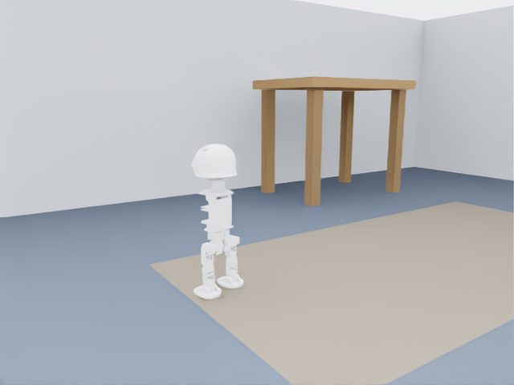
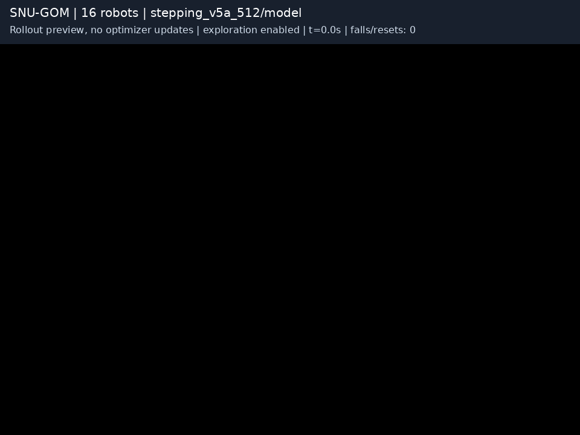

# SNU GOM · 스누곰

**A small bear-inspired robot for walking, looking at people, and expressive interaction at home.**

[English](#english) · [한국어](#한국어) · [Run experiments](HEADLESS_TRAINING.md) · [Training plan](WALKING_TRAINING_PLAN.md) · [Measured results](docs/experiments/isaac-headless-baseline.md)



*The current supplied URDF in Isaac Sim—not a photograph or a fabrication-qualified final assembly.*

<a id="english"></a>

## Current Design

The repository includes the **latest supplied 12-joint robot**, STL meshes, mass-estimate source tables, and a headless Isaac Sim walking-training pipeline. The vision remains a friendly bear-like companion; the geometry and joint layout have evolved beyond the earlier proxy and CAD previews.

| Part | Current supplied model |
| --- | --- |
| Legs | Five joints per leg: **hip yaw, hip roll, hip pitch, knee pitch, ankle pitch**; no ankle-roll joint |
| Head | **Neck yaw and pitch**; 12 actuated joints overall |
| Motor allocation | Four XC330-M288-T at hip pitch/knee pitch; eight XL330-M288-T elsewhere, according to the supplied parts guide |
| Estimated mass | **1.193 kg**, including explicit electronics, battery, wiring, and shell allowances—not a measured finished-robot mass |
| Robot description | 13 physical rigid bodies, 79 visual instances, 67 STL files, 29 simplified box colliders |
| Intended electronics/HRI | Pi 4, OpenRB-150, torso IMU, nose camera, microphone/audio board, and speaker; integration remains work in progress |
| Simulation control | Ten leg actions at 50 Hz; physics at 500 Hz; the neck is currently held at a bounded neutral target |

The current simulation model is [snu_gom_preview_relative.urdf](snu_gom_description/urdf/snu_gom_preview_relative.urdf).
Read the [model guide](snu_gom_description/docs/START_HERE.txt), [mass assumptions](snu_gom_description/docs/MASS_ASSUMPTIONS.txt), and [joint/motor table](snu_gom_description/config/joint_parameters.csv) before changing it. Joint effort/speed limits remain **provisional**. Validated walking has not been demonstrated on the physical robot.

## Progress: What Works, What Does Not

**Latest update: November 17, 2026 (KST).**

| Milestone | Evidence / status |
| --- | --- |
| Import the detailed robot | Passed joint-frame, mass, full inertia-tensor, and center-of-mass checks |
| Initial standing | Bounded position controller stayed upright for 10 seconds; approximately 3.3 mm drift |
| Train and replay PPO | Completed a 250-update, 2.05-million-transition baseline; checkpoints and TorchScript export verified |
| Baseline learned locomotion | Stayed upright for 20 seconds, but **slid/pivoted without clear foot lifts**—not a successful walk |
| Lightweight home scene | Primitive walls, sofa, and table; clear lane; no heavy household meshes or camera observations |
| Natural stepping | [Latest supported-lift reward test](docs/experiments/stepping-v5-diagnostics.md): a right-foot lift appears, but all three trials fall around 3.3 s before landing; walking still fails |
| Turn, move the head, navigate | Planned after repeatable straight walking and stopping; not demonstrated capabilities |
| Physical transfer | Not validated; actuator calibration, measured masses, safety, and hardware testing remain necessary |
| BAM actuator experiment | [Opt-in XL330 M1 adapter](docs/experiments/bam-actuators.md); equation parity checked, XC330s remain provisional, initial standing trial fails—no sim-to-real improvement demonstrated yet |

The initial 0.5 m target is a **validation milestone**, not a fixed-distance animation or the final intended capability. The longer-term aim is one command-driven walking/turning controller, a separately commanded neck, and higher-level home behaviors.

### Watch the Experiments



*Sixteen robots replaying the latest reward-ablation checkpoint with exploration and fall resets. This is a rollout preview—not footage of optimizer updates or proof of walking.*

[Updated single-robot MP4](docs/experiments/media/stepping-v5/flat.mp4) · [Same checkpoint at home](docs/experiments/media/stepping-v5/home.mp4) · [Updated 16-robot MP4](docs/experiments/media/stepping-v5/parallel.mp4) · [Experimental checkpoint](policies/stepping-v5a/README.md)

[Parallel MP4](docs/experiments/media/isaac-baseline/parallel-early.mp4) · [Standing video](docs/experiments/media/isaac-baseline/standing.mp4) · [Baseline flat rollout](docs/experiments/media/isaac-baseline/ppo250-flat.mp4) · [Baseline home rollout](docs/experiments/media/isaac-baseline/ppo250-home.mp4) · [Training curves](docs/experiments/media/isaac-baseline/training-progress.png)

The baseline videos intentionally show the remaining sliding failure. New policies must be assessed using foot clearance, alternating touchdowns, stride length, heading drift, and survival—not training return alone.

**Published walking experiment:** [v5A diagnostics and measured results](docs/experiments/stepping-v5-diagnostics.md). Supported-lift/unloading rewards produced a foot lift but lost balance: zero qualified landings in three flat/home trials. The 100-update run is stopped. The [v4 checkpoint](policies/support-v4/README.md) remains the more stable published baseline, though it slides rather than walks.

**Latest development:** the shorter-support v6 trial survives three 12-second flat evaluations but advances only 12–14 mm with zero qualified steps. Separately, [BAM actuator integration](docs/experiments/bam-actuators.md) is being validated for future sim-to-real work; it is not a walking improvement. Next: actuator validation and balanced lift-and-land control, not higher speed or terrain difficulty.

## Clone and Experiment

```bash
git clone https://github.com/mjcha924/snu-gom.git
cd snu-gom
```

All required detailed-model URDF/STL assets are included; no private CAD download or Git LFS setup is needed. Follow the **[headless setup and command guide](HEADLESS_TRAINING.md)** to install the pinned Isaac environment, validate the robot, train, and render GIFs/MP4s. Training has no cameras; videos are rendered separately.

The initial camera-free baseline ran on an **RTX 3070 / 8 GB**. Its 256-environment run used approximately 3.2 GB total GPU memory at the end. This does not establish capacity for large scenes or vision-based training.

| Work on… | Start here |
| --- | --- |
| Geometry, masses, and joint limits | [Detailed robot package](snu_gom_description/) |
| Walking environment and PPO | [Policy code](snu_gom_walk/) · [training guide](HEADLESS_TRAINING.md) |
| Curriculum and acceptance gates | [Walking plan](WALKING_TRAINING_PLAN.md) |
| Results and failure analysis | [Experiment report](docs/experiments/isaac-headless-baseline.md) |
| Camera, speech, and expressive interaction | [HRI design](docs/HRI.md) |
| Electronics and budgets | [Electronics](docs/ELECTRONICS.md) · [BOM](hardware/bom/README.md)—older assumptions need reconciliation with this model |
| Contributing | [Team workflow](CONTRIBUTING.md) · [Open tasks](https://github.com/mjcha924/snu-gom/issues) |

### Earlier Designs

The [0.6 kg proxy](robot/), older 11-motor design documents, and [CAD v0.3 previews](docs/PAPER_DESIGN.md) remain for history and comparison. They are **not** the current training geometry or joint contract. Earlier nine-joint material is in [legacy documentation](docs/legacy/README.md). The supplied detailed CAD package retains its original metadata and third-party licensing caveats.

---

<a id="한국어"></a>

## 현재 설계

**집 안에서 걷고, 사람을 바라보고, 말과 움직임으로 반응하는 곰 모양 로봇을 목표로 합니다.** 최신 제공 모델의 URDF·STL·질량 추정 자료와 Isaac 헤드리스 학습 코드를 포함했습니다. 상단 이미지는 상세 골격·머리 모델의 시뮬레이션이며 실물 사진이나 제작 완료 도면이 아닙니다.

| 항목 | 현재 제공 모델 |
| --- | --- |
| 다리 | 다리당 5축: **고관절 yaw/roll/pitch, 무릎 pitch, 발목 pitch**; 발목 roll 없음 |
| 머리 | **목 yaw와 pitch**; 총 12개 구동 관절 |
| 모터 배치 | 고관절 pitch·무릎 pitch에 XC330 4개, 나머지에 XL330 8개; 제공 부품 가이드 기준 |
| 추정 질량 | **1.193 kg**; 전장·배터리·배선·외장 여유 질량 포함, 실측값 아님 |
| 모델 | 물리 강체 13개, 시각 인스턴스 79개, STL 67개, 단순 박스 충돌체 29개 |
| 제어 | 물리 500 Hz, 다리 정책 50 Hz; 현재 목은 제한된 중립 목표로 유지 |

[모델 시작 안내](snu_gom_description/docs/START_HERE.txt)와 [질량 가정](snu_gom_description/docs/MASS_ASSUMPTIONS.txt)을 먼저 확인하세요. 토크·속도 한계는 아직 임시값이며 실물 보행을 검증한 상태가 아닙니다.

## 진행 상황

- **확인됨:** URDF 관절 좌표·질량·관성·무게중심 검증, 초기 10초 기립, PPO 학습·체크포인트·영상·정책 내보내기.
- **첫 학습 결과:** 250회 업데이트 후 20초 동안 넘어지지 않았지만 발을 들지 않고 미끄러지며 회전했습니다. **보행 성공이 아닙니다.**
- **최신 실험:** 지지 발 하중과 발 들기를 보상하는 v5A를 512개 환경에서 100회 업데이트했습니다. 오른발이 약 10–11 mm 들렸지만, 평지·실내 각 3회 평가에서 모두 약 3.3초 후 착지 전에 넘어졌습니다. 명확한 착지는 0회이며 보행 성공이 아닙니다. 학습은 중단했고, 기존 v4를 더 안정적인 비교 기준으로 보존합니다. [진단·측정 결과와 영상](docs/experiments/stepping-v5-diagnostics.md)을 참고하세요.
- **실내 환경:** 벽·소파·테이블을 단순 박스로 구성해 부담을 줄였습니다. 아직 장애물 인식·회피 정책은 아닙니다.
- **다음 단계:** 반복 가능한 직진·정지 → 회전 → 걸으며 목 움직이기 → 실내 행동. 실물 전이는 별도 검증이 필요합니다.

0.5 m는 첫 검증 목표일 뿐 최종 이동 범위가 아닙니다. 위 16대 GIF는 최신 정책의 탐색·넘어짐·재시작을 보여주는 재생 영상이며, 최적화 실행 화면이나 보행 성공 증거가 아닙니다.

팀원은 저장소를 clone한 뒤 **[실행·설치 안내](HEADLESS_TRAINING.md)**, **[단계별 계획](WALKING_TRAINING_PLAN.md)**, **[실험 결과](docs/experiments/isaac-headless-baseline.md)**를 참고해 재현하고 실험할 수 있습니다. 상세 모델에 필요한 URDF/STL은 모두 포함되어 있습니다. 이전 0.6 kg 프록시·11모터 설계·CAD v0.3 문서는 비교용 과거 자료이며 현재 학습 모델과 구분해 주세요.
