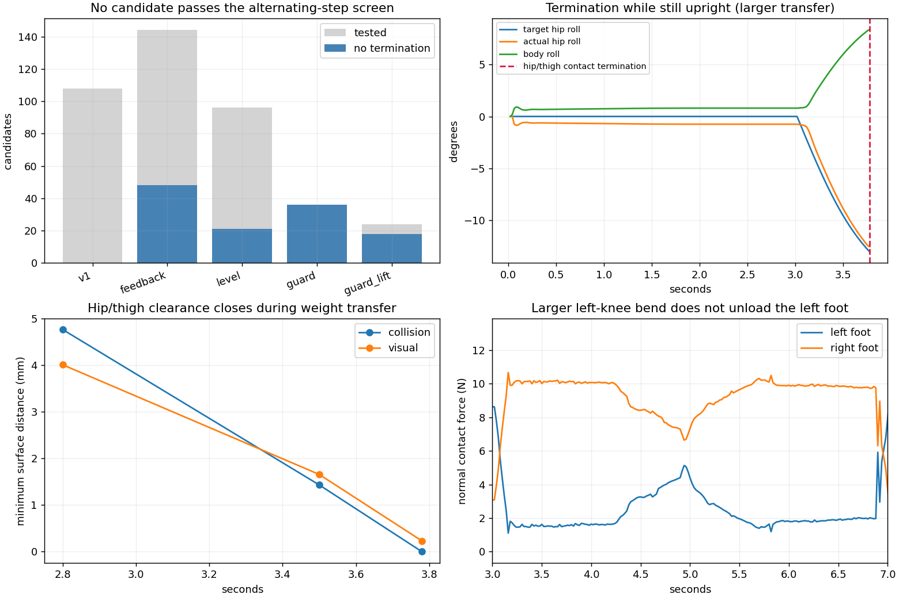

# Flat-floor recovery: support transfer before more PPO

November 17, 2026. **Walking is still not validated.** This session tests
scripted free-base controllers, not new learned policies. All tests use the flat
floor, unchanged URDF/STLs, original implicit actuators, existing motor limits,
self-collision, and original termination thresholds. BAM remains disabled.



[Results and candidate parameters](media/flat-recovery/analysis.json) ·
[Hip-clearance pose scan](media/flat-recovery/hip-clearance-scan.json) ·
[Recorded contact traces](media/flat-recovery/contacts-trace.json)

## What changed

The [preceding stall audit](walking-stall-diagnosis.md) found a reward preference
for standing, an unvalidated support reference, and near-25 Hz learned target
chatter. Instead of another reward-weight guess, this session isolates the
physical weight-transfer/lift/landing problem:

1. Smooth joint targets transfer weight before the knee-lift pulse. Stance
   posture, lean, lift amplitude, pitch bias, and period vary across candidates.
2. Optional IMU pitch/rate feedback adjusts ankle targets, bounded to ±0.15 rad,
   to test whether sagittal stabilization helps. It does not apply root forces.
3. Optional swing-foot leveling was tested, **not adopted**: it did not create
   alternating steps and some trials toppled.
4. A contact audit distinguishes true tilt falls from non-foot self-contact
   termination. Larger transfer exposed hip/thigh clearance problems.
5. An optional asymmetric target guard avoids large inward hip roll:
   left target >= −0.18 rad, right target <= +0.18 rad. This is a conservative
   experimental controller constraint, **not a certified joint limit**. Physical
   limits, collision shapes, and termination thresholds remain unchanged.

All actions still pass through position and target-velocity bounds. No hidden
balance forces, prescribed root poses, terrain modifications, or optimizer
updates are used. The gait search is parameter screening, not a trained policy.

## Results

| Screen | Candidates | Horizon | No termination for full horizon | Alternating-step screen passes |
| --- | ---: | ---: | ---: | ---: |
| Smooth open-loop transfer | 108 | 18 s | 0 | 0 |
| Pitch-feedback grid | 144 | 18 s | 48 | 0 |
| Larger lift / swing leveling | 96 | 30 s | 21 | 0 |
| Inward-roll guard | 36 | 24 s | 36 | 0 |
| Guard plus larger, slower lift | 24 | 30 s | 18 | 0 |

These grids have different parameter ranges; survival percentages are not an
apples-to-apples policy ranking. The stepping screen requires survival, at least
two qualified landings per foot, and at least three alternations. It does not
replace the separate forward-walking, slip, actuator, or start/stop gates.

One guarded candidate recorded **one left landing and no right landings**.
Its 2.079 mm maximum clearance is marginal, and it also clipped position targets
and exceeded nominal joint speed. It is not a valid walking candidate. Larger
knee excursions alone mostly keep both feet loaded or induce a pitch fall.

An intermediate 96-candidate lift screen also produced zero qualified landings
(22 survivors at 24 s). Its probe file was edited during execution, so its
end-of-run script hash does not identify the executed instrumentation reliably.
It is retained locally as exploratory evidence, excluded from the published
408-candidate screen summary, and not used to promote a controller. Subsequent
probe hashes are captured before stepping; the focused contact replays and
published screens use frozen controller code during simulation.

## New blocker: hip/thigh clearance

In a focused nominal replay (0.1 rad stance knee, 0.30 rad transfer, 0.30 rad lift,
8 s period, pitch gains 0.7/0.03), the unguarded controller terminates at **3.78 s**.
Root height and tilt remain inside the standing limits. Contact norms of
approximately **2.27 N** appear on both `left_hip_yaw_link` and `left_thigh_link`.
This is a non-foot contact termination, not a robot that has already toppled.

A separate CPU geometry query at the recorded joint pose finds:

- The hip-yaw motor box and thigh side-plate box intersect.
- The supplied visual triangle meshes still have approximately **0.231 mm**
  surface clearance at that exact pose. Proxy conservatism matters near contact.
- A wider pose scan finds actual supplied visual-mesh surface intersections at
  left inward roll −0.25 rad and right inward roll +0.25 rad, across the five
  tested hip-pitch angles. At ±0.20 rad inward roll the minimum visual clearances
  are approximately 0.65 mm (left) and 0.83 mm (right).

Therefore, simply deleting the collision pair would hide a real geometric
concern rather than establish physical feasibility. The visual CAD is itself
not a tolerance-qualified manufacturing model; these results require review,
not an automatic redesign or a claim that the hardware cannot walk.

The otherwise matched guarded 8 s-period candidate survives its 24 s screen
without qualified landings. Avoiding this collision is useful progress, but
**collision-free rocking is still not walking**.

## What remains unresolved

- Dynamic transfer does not reliably unload the intended swing foot before knee
  flexion. In a measured large-lift case, bending the left knee increases left
  loading instead of creating a supported step.
- Two ideal guarded single-support poses pass the vertical static effort audit
  at about 38%/42% of provisional effort limits. This does **not** validate the
  transition into them, frictional/contact dynamics, or hardware. Static balance
  and dynamic reachability must not be conflated.
  [Audit poses](media/flat-recovery/guard-static-reference.json) and
  [static result](media/flat-recovery/guard-static-support.json) are preserved;
  these are two diagnostic poses, not a playable motion reference.
- Actual substep joint speeds can exceed the nominal 1 rad/s setting. Target
  clipping and actuator tracking must be screened separately from survival.
- The original learned-policy jitter and standing-friendly reward remain
  unresolved. The environment source and saved policy are deliberately unchanged
  so the published checkpoint still replays with matching hashes.

## Video checkpoints

[Close-up hip collision inspection](media/hip-collision-closeup/hip-collision-closeup.mp4)
isolates the orange hip-yaw motor housing and magenta thigh side plate:

- **0–3 s:** assembly context from the supplied CAD.
- **3–13 s:** slowed reconstruction of recorded joint poses, with cyan outlines
  of the simulator collision boxes. At the recorded 3.78 s termination, boxes
  intersect while the visual surfaces remain approximately **0.231 mm apart**.
- **13–22 s:** explicitly labeled hypothetical CAD-only sweep to **−0.25 rad
  (−14.32°)** inward left hip roll. The supplied visual meshes then intersect.
  This is not footage of the physical simulation reaching that pose.

The root is fixed for inspection; no physics steps or training updates occur
after initialization. Other components are hidden in the close-up, without
changing the inspected mesh geometry. The yellow circle is a screen annotation.
[Geometry checks and provenance](media/hip-collision-closeup/inspection.json)
accompany the clip. This identifies both conservative box contact and a supplied
CAD clearance concern, not certified interference in the manufactured assembly.
Review assembly/clearance or avoid the offending range; simply disabling
self-collision would hide rather than solve the problem.

[Latest 16-robot guard comparison](media/flat-recovery/guard-comparison-16.mp4)
tests eight unguarded and eight guarded robots with otherwise matched controller
settings and independent ±0.005 rad initial joint perturbations (seed 91).
All eight unguarded trials terminate on hip/thigh contact at 3.78 s; **all eight
guarded trials survive 12 s**. Both groups have zero qualified landings. This
isolates a useful contact-avoidance improvement, not walking or policy learning.
[Detailed summary](media/flat-recovery/guard-comparison-16-summary.json).

[16-robot diagnostic comparison](media/flat-recovery/diagnostic-16.mp4) shows four
groups of four: open loop, pitch-stabilized, larger unguarded transfer, and swing
leveling. Each has a small initial joint perturbation. Four pitch-stabilized
trials survive 12 s; all controllers still have zero qualified landings.
Terminated environments reset in the video; measurements retain the first trial.
The overlay explicitly says **scripted feasibility test, not a trained policy**.

These clips are diagnostic progress, not new walking demonstrations.

## Next acceptance gates

1. Audit collision-free hip-roll/hip-pitch combinations against both proxies and
   supplied meshes. Keep a clearance margin; do not silently remove collisions.
2. Replace fixed-time knee flexion with a validated transfer/unload/lift/land
   sequence. Measure support load, CoM motion, torso roll/pitch, joint tracking,
   and slip. Simulator contact feedback may assist diagnosis, but a deployable
   controller needs a documented sensor/estimator contract.
3. Require repeated alternating supported landings with a margin above the
   2 mm clearance threshold, zero position clipping, and acceptable measured
   actuator behavior across perturbed starts. A lone marginal event is a fail.
4. Only after a feasible motion exists, version a smooth residual controller and
   rewards for stable completed alternating steps and coherent forward motion.
   Compare against neutral holding and sliding before a bounded PPO run.
5. Validate 0.5 m / 30 s flat walking across at least 20 trials, plus separate
   stopping, slip, multiple seeds, and actuator checks. Home terrain stays later.

No PPO job is left running after these screens. Do not keep extending the old
checkpoint simply because it stays upright or its return improves.

## Reproduce

Run from the workspace using the pinned Isaac environment in
[the setup guide](../../HEADLESS_TRAINING.md). No environment/package/model files
need modification. Candidate JSON files preserve original ordering.

```bash
python scripts/probe_flat_gait.py --output reports/open-loop.json --seconds 18 --headless
python scripts/probe_flat_gait.py --candidates docs/experiments/media/flat-recovery/guard-candidates.json --seconds 24 --output reports/guard.json --headless
python scripts/probe_flat_gait.py --candidates docs/experiments/media/flat-recovery/video-candidates.json --seconds 12 --initial-joint-noise .005 --seed 73 --video --output reports/diagnostic-16.json --headless
python scripts/probe_flat_gait.py --candidates docs/experiments/media/flat-recovery/guard-video-candidates.json --seconds 12 --initial-joint-noise .005 --seed 91 --video --output reports/guard-comparison-16.json --headless
```

Optional CPU mesh clearance audit (dependencies stay inside the workspace):

```bash
python -m pip install --target .deps/collision-audit --no-deps -r requirements-collision-audit.txt
python scripts/audit_hip_clearance.py docs/experiments/media/flat-recovery/contacts-trace.json --candidate 4 --scan --output reports/hip-clearance.json
python scripts/render_hip_collision.py --output reports/hip-closeup --headless
```

The FCL query measures surface intersections/distances, not certified solid
clearance, mechanical compliance, contact forces, or manufacturing tolerance.
