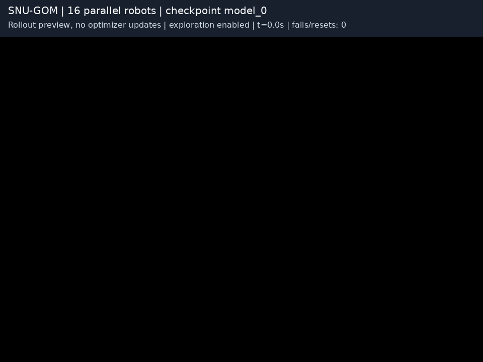
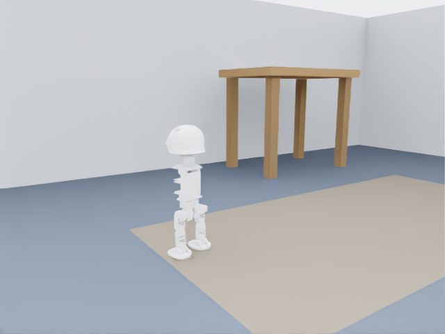

# Detailed SNU-GOM: headless Isaac baseline

Date: 2026-11-16. This report concerns the supplied 12-joint, approximately 1.193 kg
robot in `snu_gom_description/`, **not** the older 0.6 kg proxy in `robot/`.

## What is implemented

- Isaac Sim 5.1 / Isaac Lab direct environment, floating base, original joint axes,
  source mass/inertia, 29 primitive collision boxes, and self-collision enabled.
- Ten leg position actions; two separately held neck joints; 500 Hz physics and
  50 Hz policy control; original provisional 0.15 N·m / 1 rad/s actuator limits.
- RSL-RL PPO, full checkpoints, model/source hashes, source snapshots, TensorBoard
  logging, deterministic evaluation, TorchScript export and action-equivalence check.
- Headless MP4/GIF review in a separate process from training.
- A basic home scene with nine static box colliders, a clear walking lane, and a
  cosmetic flush rug. No photorealistic assets or vision/navigation policy.
- Seven CPU tests for the model/runtime; the previous proxy and motion-core checks remain intact.

## Measured initial results

| Check | Result | Meaning |
| --- | --- | --- |
| Headless startup | Pass, 100 physics steps | GPU/runtime works |
| Imported physical mass | 1.19250727 kg | Matches source estimate |
| Import joint motion | 21 poses; position error ≤1.06e-7 m; rotation error ≤7.37e-6 rad | Kinematics preserved |
| Principal inertias | Maximum relative error 3.14e-7 | Principal moments preserved |
| Full inertia tensors / CoM | Relative tensor error ≤2.24e-7; CoM error ≤2.22e-9 m | Full inertial data preserved |
| Initial standing controller | 10 seconds upright; 3.33 mm horizontal drift | Initial stance passes |
| PPO smoke | 64 environments, 20 updates, 40,960 transitions, 32.80 seconds | Learning/checkpoint pipeline works |
| Smoke export | TorchScript actions match original policy | Export plumbing passes |
| Smoke playback | Falls after 1.10 seconds, travels 0.097 m during fall | **Not walking** |

The longer baseline completed **250 updates / 2,048,000 transitions in 444.44 s**
(approximately 4,608 transitions/s). Its export action-equivalence check passed.
Deterministic playback stayed upright for 20 s on the flat floor, but had **zero
lifted-foot touchdowns**. The robot slid/pivoted around a curved path; its final
forward/lateral displacement was +0.104/+0.093 m, not a successful 0.5 m walk.
The 10 s home rollout also stayed upright with zero clear steps.

The mean body-frame forward speed was 0.0376 m/s, close to the 0.04 m/s command,
despite the poor net displacement and missing steps. This is a concrete example of
reward exploitation: good velocity tracking alone did not produce a usable gait.
The yaw-tracking exponential can saturate near zero, allowing continuous turning
without further penalty. The current slip/contact rewards are too weak to prevent
the discovered behavior. These are diagnoses for the next experiment, not claims
that revised rewards have already been tested.

## Selected checkpoints

The eight-second grid clip samples the first saved policy in 16 environments with
exploration enabled and automatic fall resets. It is a **rollout preview with no
optimizer updates**, not evidence of successful walking.
[Download the grid MP4](media/isaac-baseline/parallel-early.mp4).

- [Initial 10-second standing controller](media/isaac-baseline/standing.mp4)
- [Early PPO failure](media/isaac-baseline/smoke-fall.mp4)
- [250-update flat rollout: sliding, not walking](media/isaac-baseline/ppo250-flat.mp4)
- [250-update home rollout: sliding, not walking](media/isaac-baseline/ppo250-home.mp4)
- [Training curves](media/isaac-baseline/training-progress.png)
- [Flat metrics](media/isaac-baseline/ppo250-flat.json) and [home metrics](media/isaac-baseline/ppo250-home.json)

Videos and small summary files are committed; large local runs and converted assets
are not. The latest policy is **not** labeled a validated walking controller.

## Hardware assessment

This workstation has an RTX 3070 with 8 GB VRAM, a Ryzen 7 3700X, and approximately
32 GB RAM. The 64-environment run used 2,846 MiB total GPU memory at the end; a sample
during the 256-environment run was 2,944 MiB, and its end measurement was 3,197 MiB.
These are samples, **not peak-memory
measurements**. The reduced camera-free setup fits; simultaneous camera training,
large household scenes, and thousands of environments have not been validated.

## Reproduce and interpret

Follow [the team setup guide](../../HEADLESS_TRAINING.md). Keep the checkpoint's
`config.json` and source version with it. Local runs and caches are excluded from
Git; teammates can train new runs from the included URDF/STLs without private CAD.

Review both a flat and a home rollout. Count lifted-foot touchdowns (clearance over
2 mm followed by contact), alternating landings, survival, and speed error. A policy
that stays upright while sliding forward has not passed the walking milestone.

The first milestone is continuous controllable walking, tested over 0.5 m—not a
hardcoded 0.5 m animation. Turning, bounded gaze motion while walking, friction/rug
variation, start/stop transitions, multiple seeds, and physical transfer remain
separate validation stages in [the plan](../../WALKING_TRAINING_PLAN.md).

## Known limitations

- All masses are estimates, not weighed parts. Motor effort/speed limits remain
  provisional; standing does not validate motor thermal or continuous torque limits.
- The actor has no camera or obstacle perception. Room decoration is not navigation.
- Implicit PD/contact dynamics have not been matched against physical servos.
- Full shutdown hangs in this installed Isaac runtime; scripts save outputs before
  immediate shutdown and preserve a nonzero status for uncaught errors.
- Isaac Sim 5.1 is pinned for this local baseline, not claimed to be the newest release.
- The supplied CAD assets retain their original licensing/provenance caveats.

## 팀 요약

제공된 최신 12축 URDF/STL과 헤드리스 Isaac 학습·평가 코드를 공유합니다.
초기 정지 자세와 학습/저장/재생 파이프라인은 확인했지만, 첫 짧은 PPO 정책은
넘어졌으므로 보행 성공이 아닙니다. 발 들림·교대 착지·생존 시간과 영상을 함께
확인한 뒤 다음 단계로 진행합니다. 회전·시선 제어·실내 장애물 대응·실물 전이는
아직 별도의 검증이 필요합니다.

250회 업데이트 후 정책은 평지에서 20초간 넘어지지 않았지만 발을 들지 않고
미끄러지며 회전했습니다. 따라서 0.5 m 보행 목표는 통과하지 못했습니다.
평지·단순 실내 영상과 측정값을 함께 공개하며 다음 실험에서 발 미끄럼과
의도하지 않은 회전 보상 문제를 수정할 예정입니다.
