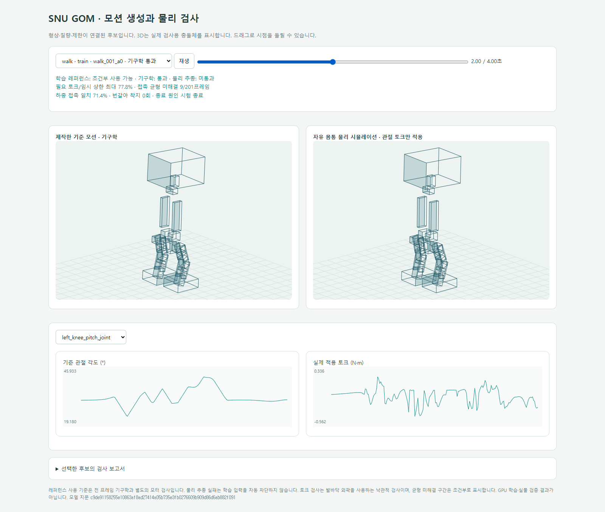

# Motion pipeline: local CPU validation / 로컬 검증

2026-11-21 KST · `feature/urdf-motion-pipeline` · [한국어 실행 안내](../MOTION_PIPELINE_KO.md) · [English guide](../MOTION_PIPELINE.md) · [Machine-readable evidence](motion-pipeline-local.json)

The URDF-to-reference-to-training-input path was exercised locally. **No new Isaac run, GPU training or hardware test was performed.** Kinematic and independent motor screens now admit references by default; tracking qualification remains separate. [Hip-roll causal diagnosis](hip-roll-torque-diagnosis.md).

URDF 변경 감지부터 기준 생성·전 프레임 검사·물리 검사·확인 화면·학습 입력 연결까지 로컬에서 확인했습니다. **Isaac의 새 경로 실행·GPU 학습·실물 검증은 하지 않았습니다.** 보행 후보를 만든 것과 안정적인 물리 보행 성공을 구분합니다.

## Results / 결과

Each reference contains 201 frames at 50 Hz over 4 seconds, with a separate one-second physical settling interval. The source model mass is approximately 1.193 kg; parameters remain provisional.

| Clip | Split | Kinematics | Reference eligibility | Tracking dynamics |
| --- | --- | --- | --- | --- |
| `stand_000_a0` | train | Pass / 통과 | Yes / 사용 가능 | Pass / 통과 |
| `walk_001_a0` | train | Pass / 통과 | Conditional / 조건부 | Fail / 미통과 |
| `stand_002_a0` | val | Pass / 통과 | Yes / 사용 가능 | Pass / 통과 |
| `walk_003_a0` | val | Pass / 통과 | Conditional / 조건부 | Fail / 미통과 |

Standing tracking RMSE was about 0.0044° for train and 0.0042° for val, with maximum torso tilt about 2.03°. These numbers describe the current model and short test, not hardware accuracy or robustness.

기립은 train/val 모두 4초 시험을 유지했습니다. 관절 추종 RMSE는 약 0.0044°/0.0042°, 최대 몸통 기울기는 약 2.03°입니다. 현재 모델의 짧은 시험 수치이며 실물 정확도나 외란 강인성의 검증은 아닙니다.

Both walking rollouts survived the four seconds, with approximately 58.8% / 56.7% intended path progress and 0.373° / 0.426° joint tracking RMSE. Torso tilt remained below 3.19°. Qualified alternating landings remain zero, so neither is dynamically qualified. The earlier validation walk had fallen; that result was not relabeled as a success.

수정 후 보행 train/val 모두 4초 동안 넘어지지 않았고 전진은 목표의 58.8% / 56.7%, 관절 추종 RMSE는 0.373° / 0.426°였습니다. 실제 한 발 하중 지지는 약 18.9% / 18.4%지만 충분히 들고 번갈아 착지하는 조건은 미통과입니다. 물리 합격으로 처리하지 않았으며, 기구학·모터 검사를 거친 조건부 레퍼런스로 기본 학습에 연결합니다.

The independent inverse-dynamics screen solved 192 / 191 of 201 walking frames. Peak minimum maximum torque utilization was 77.8% / 78.6% of the provisional planning envelope in solved frames. The other 9 / 10 frames have unresolved contact balance, not a demonstrated torque pass. Even solved frames use optimistic outer-footprint support, so the reference remains conditional.

필요 토크 검사는 보행 201프레임 중 192 / 191프레임에서 해를 구했고, 임시 모터 상한 대비 최소 최대 토크 비율은 77.8% / 78.6%였습니다. 나머지 9 / 10프레임의 접촉 균형은 미해결입니다. 실제 좁은 구름 접촉보다 낙관적인 발 외곽을 사용하는 검사이므로 완전한 동역학 가능성이나 실물 성능을 주장하지 않습니다.

Self-collision-disabled counterfactuals reproduced baseline joint torques exactly (maximum difference 0 N·m, active self-contact force 0 N). Widening only the roll cap from 0.104 to 0.312 N·m reduced left/right saturation from 31.3% / 58.7% to 2.0% / 5.0%. Full-frame visual-mesh checks found no hip-yaw/thigh intersections in either old or new references; minimum new gap was 2.82 mm. This does not invalidate the separate large-ROM CAD interference finding.

## Checks / 확인 범위

- **67 CPU tests passed:** 8 project checks, 41 walking checks, 18 pipeline checks. Added checks cover shared CPU/Torch motor curves, explicit placeholder overrides, impossible torque/speed rejection, independent reference eligibility, true support polygons and separating geometric contacts without support force. Previous model/content/tamper/split/interpolation/contact-derivative checks remain.
- Stand `--require-dynamics` and default walk `train-plan` commands were checked without importing Isaac. Strict walking dynamics still rejects this candidate. Both train and val references were integrity-checked.
- The data ZIP passed archive integrity and whitelist checks: 22 manifest/summary/motion/metadata/validation/screen files, no credentials or environments.
- A real browser exercised clip selection, pause, timeline seeking and joint-angle/torque selection. The selected walking clip remained selected; JavaScript errors: 0.

프로젝트·보행·파이프라인 CPU 테스트 67개가 통과했습니다. 실제 브라우저에서 조건부 레퍼런스 표시, 후보 선택 유지·일시정지·구간 이동·관절 그래프를 확인했으며 JavaScript 오류는 0개였습니다.

The image displays URDF collision geometry rather than photorealistic CAD visuals. Its explicit walking failure label is intentional. GPU validation must start with the small smoke commands in the guide before a long learning run. Online command blending, infinite-cycle transitions and identified actuator/pad models remain future work.

화면은 사진이나 CAD 외관 대신 검사용 충돌 형상을 표시합니다. 보행의 “물리 미통과” 표시는 의도된 검사 결과입니다. 서버에서는 안내 문서의 작은 실행부터 확인해야 하며, 실시간 명령 전환·무한 주기 연결·실측 액추에이터/패드 모델은 후속 작업입니다.
