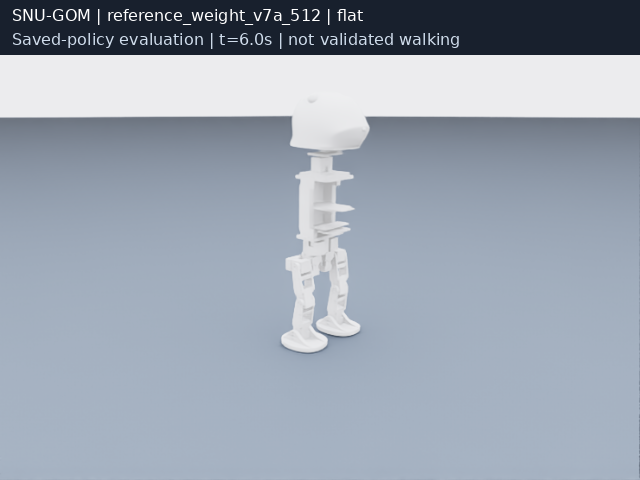

# V7A: reducing imitation pressure still produces near-standing

Date: 2026-11-17 KST. **No walking improvement demonstrated. BAM is disabled.**

## Controlled experiment

After the BAM trial failed standing, keep its adapter opt-in and continue this
locomotion experiment with the original implicit actuators. Neutral standing on
that setup still passes. Calibration and sim-to-sim work remain separate tasks.

Compare against v6's short-support reference. Change just the imitation reward
weight **3 → 1**. Preserve its 0.10 rad pulsed lean, 0.10 rad knee amplitude,
0.15-cycle swing interval, and zero fore-aft reference excursion. The command is
still 0.01 m/s, with a four-second cycle: this is stepping discovery, not an
already feasible forward gait.

No changes to upright reward, dense unloading/lift rewards, speed tolerance,
action/observation dimensions, actuator limits, self-collision, or PPO settings.
The reference still has unresolved dynamic feasibility. Do not infer that simply
tracking it more accurately would produce balanced walking.

- Fresh training, not a resumed or migrated checkpoint.
- Seed 42; 512 environments; 100 PPO updates; 1,638,400 transitions.
- 214.44 s training; approximately 7,640 transitions/s; 3,019 MiB total GPU memory
  reported at the end on the RTX 3070.
- TorchScript action-equivalence check passes.
- PPO settings and all existing v6 manifest settings match. New explicit actuator
  fields select the unchanged implicit controller; the reference weight is the
  intended experimental difference.

## Evaluation

Three 12-second trials per scene: nominal reset followed by two small joint-reset
perturbations. These are development diagnostics, not the full acceptance gate.

| Flat trial | Survives | Forward | Lateral | Heading change | Qualified steps L/R |
| --- | --- | --- | --- | --- | --- |
| 0 | 12 s | 7.62 mm | 0.66 mm | 2.23° | 0 / 0 |
| 1 | 12 s | 9.23 mm | 1.92 mm | 2.39° | 0 / 0 |
| 2 | 12 s | 9.04 mm | 1.95 mm | 3.16° | 0 / 0 |

Maximum observed minimum-sole clearance across these trials is only 0.224 mm,
well below the 2 mm qualified-step threshold. There are no alternating touchdowns.
V6 also had zero qualified steps, with 12.1–13.6 mm forward drift. V7A therefore
does not improve stepping; less displacement here is not evidence of better walking.

The same checkpoint is also evaluated on the basic home scene with matched
settings. This is the clear-floor lane, not rug, threshold, or obstacle avoidance
testing. All results are preserved in the linked metrics, not only the best trial.
The flat and home summary metrics match exactly: all six trials survive, with
zero qualified steps. This does not validate navigating furniture or floor edges.

Training logs contain a rare qualified-touchdown signal but **no alternating
touchdowns**. A rising return or full-length training episode does not establish
a walking gait. Peak observed joint speed in flat evaluation is 2.66–3.40 rad/s,
including settling; configured 1 rad/s limits still do not certify hardware
speed compliance.

## Videos and reproducibility



[Single robot MP4](media/reference-weight-v7a/flat.mp4) ·
[Same checkpoint at home](media/reference-weight-v7a/home.mp4) ·
[16-robot MP4](media/reference-weight-v7a/parallel.mp4) ·
[16-robot GIF](media/reference-weight-v7a/parallel.gif) ·
[Metrics and checkpoint hash](media/reference-weight-v7a/metrics.json) ·
[Training curves](media/reference-weight-v7a/training-progress.png)

The 16-robot clip is an eight-second stochastic saved-policy rollout with resets,
**zero optimizer updates**, and the normal training command mix (including stop
commands). It is not the 512-environment training run or a success evaluation.
No falls/resets occur in this particular eight-second grid clip; because the
robots mostly stand, that is not evidence of reliable walking balance.

[Checkpoint and replay instructions](../../policies/reference-weight-v7a/README.md).
Use the source revision introducing the checkpoint if current hashes differ.

```bash
"$SNU_GOM_PYTHON" scripts/train.py --support-reference --dense-lift --short-support \
  --reference-weight 1 --speed .01 --gait-period 4 --num-envs 512 --iterations 100 \
  --output runs/reference_weight_v7a_512 --headless
```

Use a new run directory if that name already exists. The default reference weight
remains 3 for other experiments. CPU reward tests verify that the default formula
is unchanged, scaling works, and invalid weights are rejected. All 33 walking
unit tests pass, plus the CLI rejects a non-finite reference weight before launch.

## Decision and next step

Stop at update 100. Do not extend this zero-step result or increase commanded
speed/stride. Retain the failed ablation instead of promoting it as walking.

Next isolate **supported weight transfer and a single lift/land under free-base
dynamics** before another long PPO run. Record support-knee saturation, actual
foot loads, torso pitch/roll, and tracking error. The current seed falls without
learned corrections; rewarding completed steps alone may be too sparse while
almost no such transitions are explored. Any contact-aware reference/controller
change should be its own bounded experiment, with no imposed root motion or
artificially increased motor limits. Hardware-informed actuator modeling remains
important even though BAM itself is optional.
