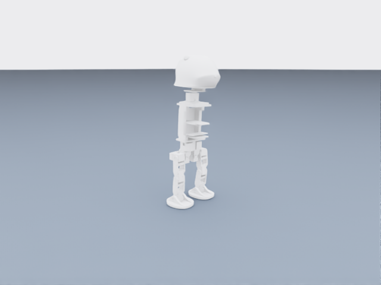

# Stepping follow-up: standing local optimum

Date: 2026-11-16. Same supplied 12-joint robot, unchanged geometry and provisional
0.15 N·m effort / 1 rad/s simulator velocity settings. **Walking still fails.**

## Changes and checks

- Mild 0.30 rad knee crouch, calculated using the actual URDF axes and forward
  kinematics. Zero-action stance survived 10 seconds with 3.64 mm horizontal drift.
- Wider bounded leg action offsets, 0.025 m/s command, 2.4 s gait period, 6 mm
  target foot clearance, and 60 mm intended same-foot stride.
- Alternating contact, swing clearance and fore-aft placement rewards; stronger
  slip penalty and nonsaturating unwanted-yaw penalty. These targets do not impose
  foot or root trajectories on the simulation.
- Touchdowns require at least 60 ms airborne and >2 mm clearance. Evaluator records
  per-foot landing displacement, unwrapped heading change, peak speed and torque.
- Eleven walking/model/runtime tests pass. Multi-trial evaluation uses `no_grad`
  rather than per-step inference mode so simulator buffers remain writable at reset.

## Measured outcome

512 environments, 250 PPO updates, **4,096,000 transitions in 495.62 seconds**
(8,264 transitions/s). TorchScript action-equivalence passed. End-of-run total GPU
memory was 3,157 MiB / 8,192 MiB; this is not a peak-memory measurement.

| Deterministic flat trial | Upright | Forward displacement | Clear touchdowns L/R | Heading change |
| --- | --- | --- | --- | --- |
| Nominal initialization | 20 s | 6.62 mm | 0 / 0 | −0.20° |
| Small joint perturbation 1 | 20 s | 5.51 mm | 0 / 0 | −1.90° |
| Small joint perturbation 2 | 20 s | 7.23 mm | 0 / 0 | −2.52° |

Both feet registered contact for 99.9% of samples. Maximum sole clearance stayed
below 0.81 mm. There are no valid same-foot stride measurements because no clear
touchdowns occurred. Anti-slip/turn shaping removed most baseline motion but the
policy settled into standing instead of learning weight transfer and stepping.
This is **not** a longer-stride policy and does not pass the 0.5 m milestone.

Measured peak joint speeds were 1.10, 2.69, and 1.09 rad/s, despite the configured
1 rad/s simulator velocity setting. Peak reported torque was approximately
0.15 N·m. Simulator speed settings therefore must not be treated as a verified
hard physical speed bound. Investigate reset/contact transients and actuator
enforcement before hardware transfer; no actuator limits were raised to force gait.

[20-second MP4](media/stepping-v2/flat.mp4) ·
[Evaluation metrics](media/stepping-v2/evaluation.json) ·
[Training metrics](media/stepping-v2/training.json) ·
[Training curves](media/stepping-v2/training-progress.png)

The MP4 is a deterministic saved-policy replay, not optimizer footage. Local full
GIF and sampled traces are in `runs/stepping_v2_512/review_model_flat_20s_3ep/`.

## Next experiment, not yet implemented

Validate a robot-specific, joint-limit- and speed-feasible stepping reference using
the actual five-axis legs, including lateral weight transfer. Check its geometry
and dynamic feasibility before trying residual-policy assistance. Investigate
contact-point slip rather than treating all foot-body motion as slipping; rolling
can be useful for this robot without ankle roll. Do not simply raise commanded
speed or run the same standing local optimum longer. Keep the old baseline and this
failed stepping experiment available for comparison.

See [setup and reproduction](../../HEADLESS_TRAINING.md) and the
[active plan](../../WALKING_TRAINING_PLAN.md).
