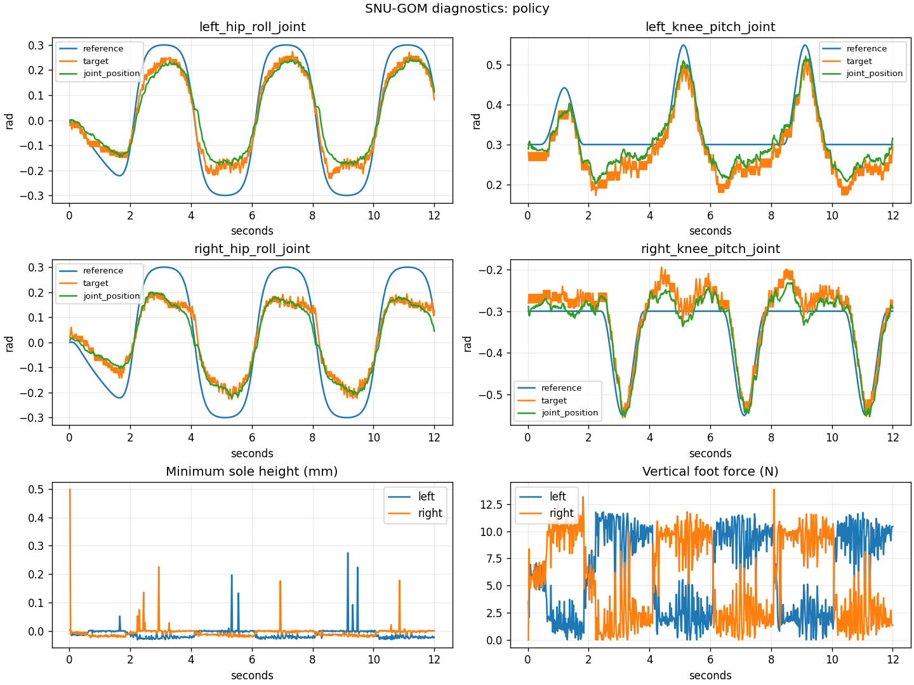
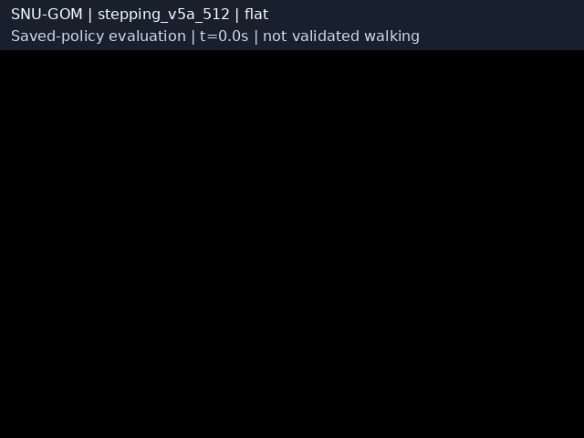

# V5: diagnose sliding, then test supported-lift rewards

Date: 2026-11-17 KST. Baseline: `da2ced7`, support-v4 final checkpoint.
Original robot geometry, self-collision, effort limits, speed settings, and flat
floor remain unchanged. No camera observations or household obstacles are added.

## Baseline measurements before changing environment source

An instrumented subclass records before autoreset and before every 2 ms physics
substep. It does not alter actions or dynamics. The saved-policy diagnostic exactly
reproduced the previous 12-second final position. Neutral and raw-seed runs use
zero residual actions; only the reference is disabled for neutral control.

| Diagnostic | Duration | Outcome | Largest minimum-sole height L/R |
| --- | --- | --- | --- |
| Saved v4 policy | 12 s | Upright; +98.97 mm forward, −39.26 mm lateral | 0.28 / 0.50 mm |
| Raw support seed | 1.12 s | Falls backward; root pitch −0.826 rad | 0.84 / 1.24 mm |
| Neutral targets | 4 s | Upright; about 3.61 mm horizontal drift | 0.84 / 1.24 mm |

The policy shifts vertical foot loads cyclically, but neither foot clears the
floor. Estimated accumulated tangential contact-point travel is 131 mm left and
122 mm right over 12 seconds. This is sampled contact-point motion, not an exact
integral of material-point slip, but supports the observed sliding diagnosis.

After two seconds, the policy's hip-roll ranges are 0.426 / 0.422 rad versus the
reference's 0.600 rad. Residuals reduce the reference motion. Target-tracking RMSE
is approximately 0.034 / 0.027 rad for hip roll; reported effort is within 5% of
the provisional limit for approximately 22% / 11% of substep samples. During the
raw-seed failure's final half, the right support knee is at its reported effort
limit throughout and has about 0.346 rad target-tracking RMSE. The seed is not a
balanced, dynamically validated demonstration to imitate more forcefully.

No non-foot contact force was detected in these three traces. That rules out a
detected collision-triggered termination in these runs, not every possible
self-collision or collision-model problem. Raw-seed failure meets the tilt
criterion. Initial settling also contributes speed spikes: substep peak speeds
are 3.79 rad/s for the policy and 4.73 rad/s for neutral control. The implicit
actuator's reported torque is a model estimate, not calibrated motor telemetry.

After two seconds, peak substep speed is 1.69 rad/s for the policy and 0.73 rad/s
for neutral standing. Thus settling explains some, but not all, policy speed-limit
exceedance. Do not claim hardware speed compliance from simulator settings alone.



[Diagnostic summary](media/stepping-v5/diagnostics.json) ·
[Unassisted seed tracking plot](media/stepping-v5/diagnostics-seed.png)

## Intervention A: isolate dense support/lift shaping

Keep the audited v4 reference and command (0.01 m/s, four-second cycle) unchanged
for this ablation. Its dynamic limitations remain explicit. Do not pretend that
lower reward targets alone constitute a new geometrically valid reference.

- Replace only the narrow Gaussian clearance reward with capped linear clearance
  progress toward the same geometry-derived target, weighted by opposite-foot
  support. Penalize overshoot through a decaying multiplier; no reward for hopping
  without support. Clearance term weight remains 4.
- Add a weight-normalized swing-foot unloading term, weight 2, also requiring
  opposite-foot support. This gives feedback before a complete lift is achieved.
- Apply these terms only to moving commands and active swing windows, while upright
  and not terminal. Keep reference tracking, speed tracking, slip penalties, actor
  architecture, actuator settings, reset state, and all other rewards unchanged.
- Track qualified touchdowns separately from reward: >2 mm sole clearance, ≥60 ms
  airborne, opposite-foot contact throughout the airborne interval and at landing.
  Reject hops, contact chatter, terminal/reset events, and zero-command stepping.
  Repeated same-foot landings are not alternating transitions.

This is a bounded reward hypothesis, not a claim that feasibility is solved.
Event/placement bonuses, reference changes, and faster commands are deferred to
avoid conflating interventions. If 100 updates produce no genuine steps, stop and
return to dynamic-reference feasibility rather than extend the run blindly.

## Reproduction

### Completed experiment A

The five-update, 64-environment smoke test passed, including exported actor action
equivalence. The main 512-environment run completed **100 updates / 1,638,400
transitions in 242.67 seconds**. Export equivalence passed; total GPU memory at the
end was 2,910 / 8,192 MiB. The intermediate evaluation briefly overlapped training,
so throughput is not an isolated hardware benchmark. Isaac and PyTorch ran on
`cuda:0` in the existing `env_isaaclab` Conda environment.

The iteration-50 checkpoint (51 completed updates) fell in all three trials after
2.78–2.86 seconds, with zero clear touchdowns. Final-checkpoint outcomes:

| Trial, flat and home | Duration before fall | Forward displacement | Maximum sole height L/R | Qualified touchdowns |
| --- | --- | --- | --- | --- |
| Nominal | 3.32 s | −42.29 mm | 0.71 / 10.27 mm | 0 / 0 |
| Perturbed 1 | 3.36 s | −41.18 mm | 0.49 / 10.84 mm | 0 / 0 |
| Perturbed 2 | 3.34 s | −42.11 mm | 0.67 / 10.75 mm | 0 / 0 |

The same checkpoint produced identical metrics in the primitive-home clear lane.
There is now a right-foot lift during the failed maneuver, but **no completed
qualified step, no alternation, and no improved walking**. All trials fall.
In the nominal trial, the right sole first exceeds 2 mm at 2.42 s while the left
foot is in contact and upright alignment is 0.985. It remains airborne when tilt
triggers termination at 3.32 s. The problem is now also completing single support
and landing, not merely detecting a lifted foot.
The v4 checkpoint remains the more stable saved baseline; training budgets differ
(250 versus 100 updates), so this is not a matched-convergence causal comparison
of reward designs. It is a failed bounded stepping-discovery experiment.



[Single-robot MP4](media/stepping-v5/flat.mp4) ·
[Same checkpoint at home](media/stepping-v5/home.mp4) ·
[16-robot exploration MP4](media/stepping-v5/parallel.mp4) ·
[Training curves](media/stepping-v5/training-progress.png) ·
[Checkpoint and reproduction](../../policies/stepping-v5a/README.md)

Single-robot videos end near the fall, not after the requested 12-second horizon.
The eight-second grid uses stochastic saved-policy rollout and automatic resets,
not live optimizer updates. These are failure-review artifacts, not success demos.
There are 24 fall/reset events across its 16 environments; some sampled zero-command
robots stand rather than attempting the moving command.

[Matched scene metrics/hash](media/stepping-v5/comparison.json) ·
[Intermediate checkpoint metrics](media/stepping-v5/checkpoint50-flat-summary.json) ·
[Training summary](media/stepping-v5/training.json)

**Decision:** stop at the bounded checkpoint. Do not increase stride/speed, start
terrain training, or add touchdown/placement bonuses yet. Next isolate a smaller,
joint-rate-feasible weight-transfer and lift/landing sequence with negligible fore-aft travel;
inspect support-knee saturation and torso pitch before restoring forward motion.
Test a shorter single-support window with more double support rather than assuming
that a slower overall cadence is safer; the current swing window is 1.4 seconds.
Any reference change must be geometry-audited and tested dynamically as a separate
experiment. The new rewards alone have not solved balance.

Validation: 24 walking tests, eight project tests, and 14 motion tests passed; one
optional legacy-mesh test skipped. Compilation and whitespace checks passed. The
new tests cover unloading/lift progress, overshoot, unsupported hopping, chatter,
low-clearance sliding, alternation, repeated feet, zero commands, terminals, and
per-environment resets.

### Commands

Use the pinned environment from [the setup guide](../../HEADLESS_TRAINING.md).
The baseline diagnostics require the baseline environment-source revision; the
policy source-hash guard must not be disabled after introducing v5 code.
For historical reproduction, place copies of the diagnostic scripts in an isolated
`da2ced7` checkout inside this workspace; the diagnostic scripts themselves are
outside the hashed environment package.

```bash
"$SNU_GOM_PYTHON" scripts/diagnose_walk.py --mode policy --seconds 12 --output reports/v5_policy_diagnostic.json --headless
"$SNU_GOM_PYTHON" scripts/diagnose_walk.py --mode seed --seconds 12 --output reports/v5_seed_diagnostic.json --headless
"$SNU_GOM_PYTHON" scripts/diagnose_walk.py --mode neutral --seconds 4 --output reports/v5_neutral_diagnostic.json --headless
"$SNU_GOM_PYTHON" scripts/summarize_diagnostics.py reports/v5_policy_diagnostic.json reports/v5_seed_diagnostic.json reports/v5_neutral_diagnostic.json --output reports/v5_diagnostic_summary.json
```

New-source experiment commands:

```bash
"$SNU_GOM_PYTHON" -m unittest discover -s tests/walking -v
"$SNU_GOM_PYTHON" scripts/train.py --support-reference --dense-lift --speed .01 --gait-period 4 --num-envs 64 --iterations 5 --output runs/stepping_v5_smoke --headless
"$SNU_GOM_PYTHON" scripts/train.py --support-reference --dense-lift --speed .01 --gait-period 4 --num-envs 512 --iterations 100 --output runs/stepping_v5a_512 --headless
```

Always start a distinct run; do not silently resume v4 under the new reward/source
contract. Freeze environment source during training and evaluation. Evaluate the
50-update checkpoint and final checkpoint on three fixed 12-second flat trials,
then render the final checkpoint and compare the same weights on the home scene.
