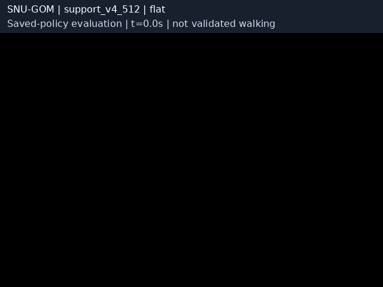
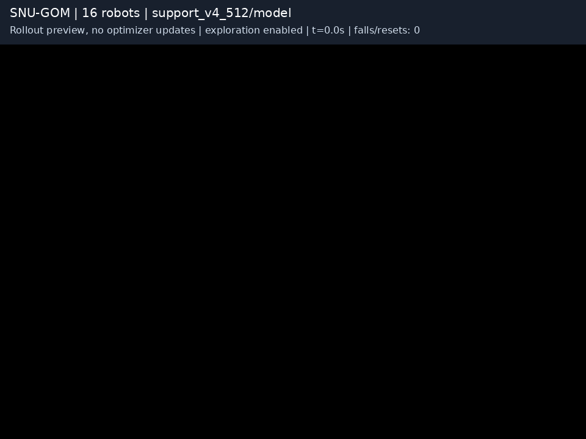

# Reference-assisted stepping experiments

Experiments started 2026-11-16 UTC. Same supplied 12-joint robot, unchanged
URDF/STLs, self-collision, and provisional 0.15 N·m / 1 rad/s settings.
Training stays on the default flat floor. Home evaluation uses the same weights,
not extra training or an automatic difficulty increase.

## Why change the reference?

The reward-only v2 policy stood rather than stepped. V3 introduced an actual-URDF
inverse-kinematics seed, a two-second target ramp, residual leg actions, and
contact-point slip measurement instead of penalizing all foot-body motion.
No root trajectory, foot trajectory, or external balancing force is imposed.

V3 completed 250 PPO updates with 512 environments: 4,096,000 transitions in
586.95 seconds. Three deterministic 30-second trials each on flat and home
survived, but all had **zero clear touchdowns**. Forward displacement was only
8.14, 11.24, and 11.84 mm, identical on both scenes. This is standing, not walking.
The clear-lane home comparison does not establish obstacle or terrain robustness.

V3 source is frozen at `dbfa33f`. Its periodic reference respected joint position
and target-speed limits, but an ideal static corner-force audit found only 6/20
sampled phases supportable within the provisional effort limits. A geometry-valid
reference is not necessarily dynamically feasible.

V4 keeps the support knee at 0.30 rad, uses a shallower swing motion and lateral
weight-transfer targets, and derives the clearance/fore-aft reward targets from
its own forward kinematics. Peak reference joint speed is below 1 rad/s. Ideal
static support improves to **18/20** sampled phases, but that calculation omits
acceleration, frictional wrench, compliance, and collision-clearance validation.
The raw seed still falls in dynamics; residual PPO must learn balance. This is an
improved seed audit, **not evidence that learned walking has improved**.

## V4 measured outcome and videos

Completed 250 updates / **4,096,000 transitions in 569.05 seconds**. Exported actor
action-equivalence passed. Total GPU memory at completion was 3,019 / 8,192 MiB
(not a peak measurement). Training is stopped; the final checkpoint is preserved.

| Same final checkpoint | Flat | Primitive home |
| --- | --- | --- |
| Deterministic diagnostic duration, survived | 12 s, yes | 12 s, yes |
| Forward displacement | 98.97 mm | 98.97 mm |
| Lateral displacement | −39.26 mm | −39.26 mm |
| Heading change | −9.20° | −9.20° |
| Clear touchdowns, left / right | **0 / 0** | **0 / 0** |
| Maximum sole clearance, left / right | 0.28 / 0.50 mm | 0.28 / 0.50 mm |

There is more forward displacement than the prior near-stationary policy, but
**this remains sliding/shuffling, not improved natural walking**. There are no
valid stride-length measurements. One nominal trial per scene is a short progress
diagnostic, not repeatability evidence or the 20-trial acceptance gate. Both scenes
produce identical metrics on the clear lane. The 0.5 m and terrain gates remain
unpassed. Peak observed joint speed was 3.22 rad/s despite the configured 1 rad/s
setting; peak reported torque remained approximately 0.15 N·m.

[Single robot: flat MP4](media/support-v4/flat.mp4) ·
[Same checkpoint: home MP4](media/support-v4/home.mp4) ·
[Matched metrics and checkpoint SHA-256](media/support-v4/comparison.json)

[16-robot MP4](media/support-v4/parallel.mp4) ·
[Grid metrics](media/support-v4/parallel-summary.json) ·
[Training curves](media/support-v4/training-progress.png) ·
[Training cost](media/support-v4/training.json)

The grid is an eight-second **stochastic saved-checkpoint rollout**, with one
fall/reset across 16 environments. It uses the actual updated policy and physics,
but performs no optimizer updates; it is not a success evaluation. Single-robot
videos are deterministic saved-checkpoint evaluations, not scripted animation.

[Cloneable checkpoint and replay instructions](../../policies/support-v4/README.md)
are included. The previous [v3 scene comparison](media/support-v4/v3-flat-home-comparison.json)
and both static audits ([v3](media/support-v4/v3-support-audit.json),
[v4](media/support-v4/support-audit.json)) are preserved for comparison.

Next technical investigation: inspect actuator saturation, support-leg tracking,
and collision clearances during actual weight transfer. Improve dynamic feasibility
before spending longer on the same reward setup or introducing terrain.

## Reproduction and interpretation

See [commands and pinned setup](../../HEADLESS_TRAINING.md). The v4 experiment is
bounded to 512 environments and 250 updates, with cameras disabled during
training. Rendering is separate to fit the RTX 3070's 8 GB VRAM.

The 0.01 m/s command and four-second gait period are deliberately slow stepping
discovery settings, not the final walking target. Do not relax the 0.5 m milestone
to accommodate them. Clear touchdowns require at least 60 ms airborne and more
than 2 mm sole clearance. Measure alternating steps and distance, not reward alone.

The next terrain stages remain gated: reliable flat walking and stopping first,
then measured friction variation, rug edges, and very low thresholds in separate
experiments. Camera-aware avoidance is a later task, not a locomotion reward hack.
Actual simulator joint speeds can exceed the configured velocity setting during
transients; actuator calibration/enforcement and collision inspection remain
necessary before hardware transfer.
