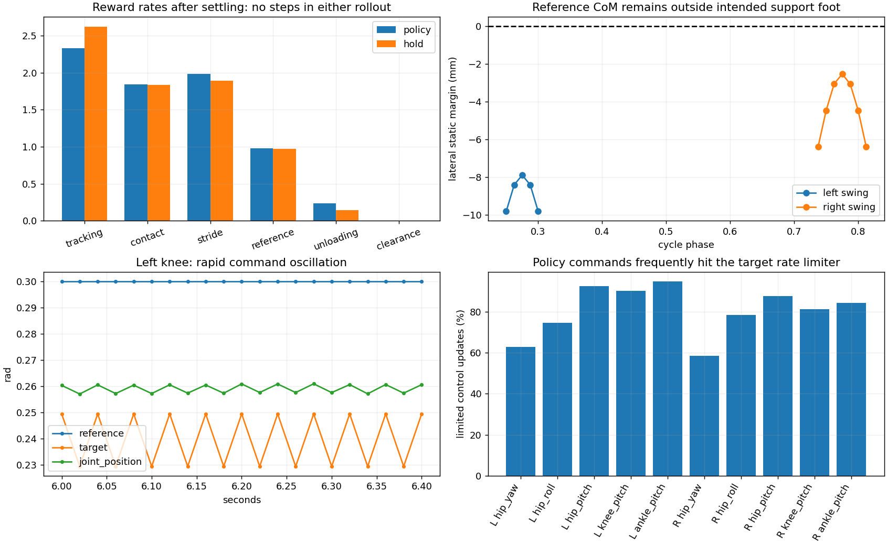

# Why flat walking stalled

November 17, 2026. The v7A checkpoint is preserved. These measurements use
zero-update diagnostic rollouts, not additional PPO training.



[Machine-readable analysis](media/stall-diagnosis/analysis.json)

## Controlled comparison

The `hold` diagnostic cancels the reference through the normal residual-action
interface to command neutral joint targets. Unlike the old `neutral` diagnostic,
it leaves the walking reference and rewards enabled. Model, controller, rewards,
command, initial state, and duration match the policy comparison.

| Controller | Duration | Fall | Forward displacement | Return | Qualified landings |
| --- | ---: | --- | ---: | ---: | ---: |
| v7A deterministic policy | 12 s | No | 7.624 mm | 99.2824 | 0 |
| Neutral targets, same task | 12 s | No | −3.613 mm | 100.2595 | 0 |
| Raw reference, zero residual | 1.74 s | Yes | −64.920 mm | 10.0789 | 0 |

The short failed reference return is not comparable to the two 12-second returns.
The policy replay reproduces the previous nominal v7A evaluation.

## Confirmed problems

1. **Standing is attractive under the current objective.** At a 0.01 m/s command
   and 0.025 m/s tracking tolerance, exact zero velocity earns 85.2% of the maximum
   tracking reward. Holding neutral earns more total reward than this policy;
   this establishes an attractive solution, not a proof of a global optimum.
   The “stride” term measures body-relative foot placement rather than completed
   strides. With zero reference fore-aft excursion, standing scores well. Qualified
   alternating touchdowns are logged, not rewarded. Dense unloading can earn
   credit before either foot leaves the floor.
2. **The reference has no validated single-support phase.** At all sampled active
   swing phases (sole target above 2 mm), the reference CoM is laterally outside
   the intended supporting foot: −9.82 to −7.89 mm for left swing, −6.38 to
   −2.54 mm for right swing. The earlier 13/20 static passes do not establish
   successful single support. Actual active swing occupies only 15% of the cycle;
   keeping both feet grounded earns approximately 1.85/2 contact reward averaged
   over the ideal reference cycle. Dynamic gaits can operate outside static
   support polygons, but this seed has no demonstrated momentum/landing strategy
   and fails its free-base replay.
3. **The policy commands rapid oscillations rather than smooth corrections.**
   After settling, joint targets reverse 45.9–49.1 times/s at a 50 Hz control
   rate. The dominant target-increment frequency is approximately 25 Hz;
   58.5–94.8% of updates per joint hit the target slew limiter. Actions do not
   hit their amplitude clip. A representative knee alternates approximately
   0.229/0.249 rad every 20 ms while its reference remains 0.3 rad. The average
   action-rate penalty is only −0.00337 against positive reward rates near 8.
   It penalizes normalized residual differences, not physical target bandwidth.
   The policy follows some of the slow reference too; it does not simply cancel
   it completely. A 25 fps recording can alias this control oscillation.
4. **The raw seed loses support under provisional actuator limits.** Its right
   support knee reaches the 0.15 N·m estimated implicit torque limit near 1 s,
   before the large forward pitch fall. Actual knee tracking error then grows.
   Those limits are marked preview-only; this does not prove the hardware cannot
   walk. Raising them without calibration would manufacture an easier task,
   not solve the physical uncertainty.

Exploratory training logs reinforce the lack of stepping discovery:

| Run, each 1,638,400 transitions | Qualified touchdown events | Alternating events |
| --- | ---: | ---: |
| v5A | 2,278 | 28 |
| v6 smaller reference | 2 | 0 |
| v7A reduced imitation weight | 1 | 0 |

These counts are reconstructed from per-update logged means. They are aggregate
exploratory events, **not successful episodes or deterministic walking trials**.
The v5A deterministic policy still falls. Reducing imitation weight alone did not
repair the reference or objective.

## What is not established

- No evidence identifies CUDA, GPU capacity, or export mismatch as the cause.
- BAM is disabled in these comparisons; it is not the explanation for v7A.
- Short rollouts/GAE credit assignment and missing actor velocity/contact history
  are secondary hypotheses, not demonstrated root causes. Bootstrapping can
  propagate value beyond a rollout.
- Static support margins do not prove dynamic walking impossible.
- The home rug is visual only. Matching flat/home metrics do not validate rug
  friction, edges, thresholds, or camera-aware navigation.

## Corrective order

We tuned rewards before demonstrating a complete physical step. Change that
order: (1) smooth weight transfer and supported lift/landing under unchanged
actuator limits, (2) repeatable alternating stepping with low slip, (3) an
objective that distinguishes walking from standing/sliding, (4) bounded PPO with
explicit target-bandwidth diagnostics, (5) independent straight-walking tests.

The next scripted feasibility screen varies posture, transfer amplitude, lift,
pitch bias, and timing. It applies joint targets only, keeps the base free,
preserves collisions and motor limits, and reports every candidate including
failures. Search-selected results are not independent validation or learned
policies. Do not begin terrain progression or another long PPO run just because
a candidate stays upright.

## Reproduce the audit

Use the pinned Isaac Python environment and unchanged v7A environment source.
All outputs stay in the workspace; the source-hash guard must not be bypassed.

```bash
python scripts/diagnose_walk.py --mode policy --checkpoint policies/reference-weight-v7a/model.pt --seconds 12 --output reports/stall_v7a_policy.json --headless
python scripts/diagnose_walk.py --mode hold --checkpoint policies/reference-weight-v7a/model.pt --seconds 12 --output reports/stall_v7a_hold.json --headless
python scripts/diagnose_walk.py --mode seed --checkpoint policies/reference-weight-v7a/model.pt --seconds 4 --output reports/stall_v7a_seed.json --headless
python scripts/analyze_stall.py --checkpoint policies/reference-weight-v7a/model.pt --reference runs/reference_weight_v7a_512/reference.json --traces reports/stall_v7a_policy.json reports/stall_v7a_hold.json reports/stall_v7a_seed.json --output reports/stall-analysis.json
```

The reference and TensorBoard logs in `runs/` are local artifacts. On a fresh
clone, rebuild the reference from the saved settings before the final command;
the published analysis retains the original measured results.
